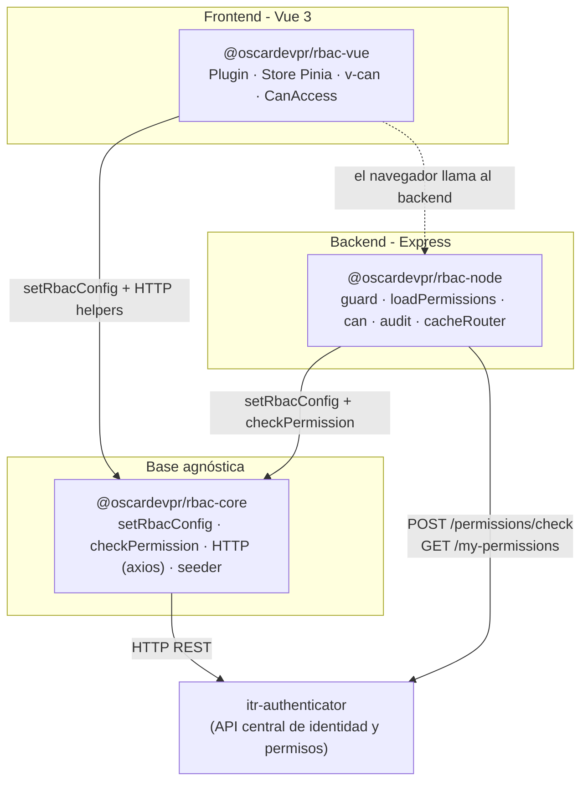
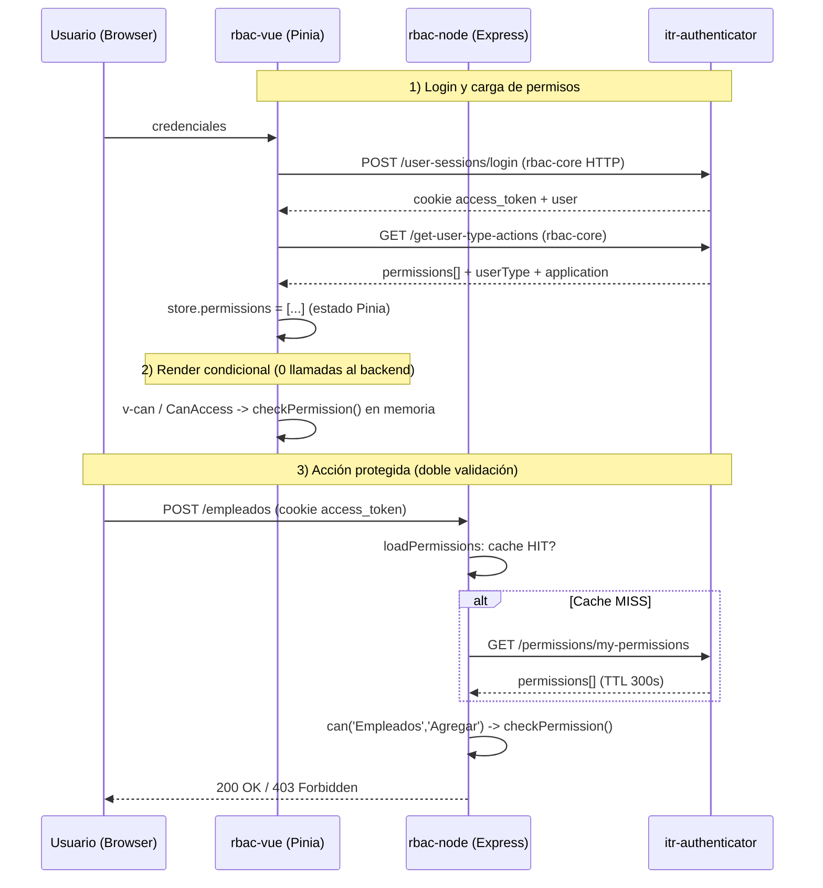
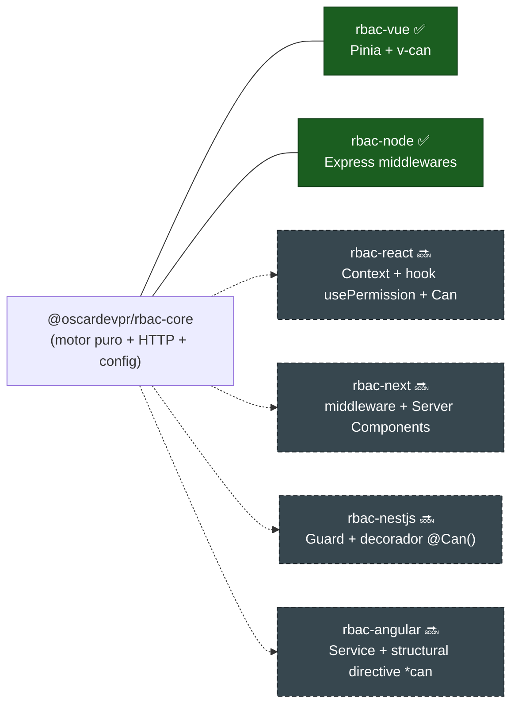
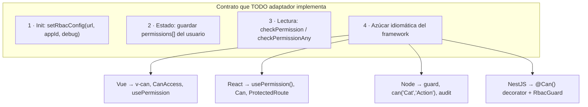

# Presentación — Ecosistema RBAC (`rbac-core` / `rbac-node` / `rbac-vue`)

---

## SLIDE 1 — Arquitectura y comunicación interna en producción

### Narración de apertura

El ecosistema RBAC se apoya en **una sola librería base, `rbac-core`**, que concentra
toda la lógica que no depende de ningún framework: la configuración global, el motor de
permisos y la comunicación HTTP con el servicio central `itr-authenticator`. Sobre esa
base se montan dos adaptadores: **`rbac-node`** (backend Express) y **`rbac-vue`**
(frontend Vue 3 + Pinia). Ninguno reimplementa la lógica de permisos: la heredan de core.
Así, la regla "¿este usuario puede hacer esta acción?" se responde **igual** en servidor
y cliente.

### Diagrama 1 — Capas y dependencias

### Diagrama 2 — Flujo en producción (login → render → request protegido)

### Párrafos de soporte

**Configuración como fuente única de verdad.** Tanto `RbacPlugin.install()` (Vue) como
`createRbacNode()` (Node) llaman a `setRbacConfig(authApiUrl, applicationId, debugMode)`.
Esa función escribe en un *singleton de módulo* que el motor y la capa HTTP de core leen
después. Configuras la URL del autenticador y el ID de la app **una sola vez por proceso**.

**Doble validación (cliente + servidor).** En el frontend los permisos sirven a la
**experiencia de usuario** (ocultar botones, render condicional) — evaluados en memoria,
sin llamadas extra. La **seguridad real vive en el backend**: `rbac-node` revalida cada
petición contra `itr-authenticator`. El frontend nunca es la frontera de seguridad.

**Rendimiento: caché con TTL e invalidación por webhook.** `loadPermissions` cachea los
permisos en memoria con clave SHA-256 del token (TTL 300s): primer request = MISS (1
llamada HTTP), siguientes = HIT (0 llamadas). Al cambiar permisos, `itr-authenticator`
invoca `POST /rbac/cache/invalidate` (`cacheRouter`). Las verificaciones por ruta
(`can()`) son puras y síncronas: cero red.

**Observabilidad sin bloquear.** `audit()` registra cada acción contra `/audit-logs` en
*fire-and-forget*: nunca bloquea la respuesta. Igual el `seeder`, que sincroniza
categorías y acciones al arrancar sin frenar el boot.

---

## SLIDE 2 — Expansión a otras tecnologías sobre `rbac-core`

### Narración de apertura

La decisión de diseño más importante fue **aislar toda la lógica reutilizable en
`rbac-core` y dejarla libre de framework**. El motor de permisos son funciones puras de
TypeScript; la capa HTTP es axios estándar. Soportar una nueva tecnología **no requiere
reescribir la lógica**: solo un *adaptador delgado* que (1) llame a `setRbacConfig` al
iniciar, (2) guarde los permisos en el estado nativo de esa tecnología y (3) exponga
`checkPermission` de forma idiomática. `rbac-node` y `rbac-vue` son la prueba.

### Diagrama 3 — Core como hub, adaptadores como radios

### Diagrama 4 — El contrato del adaptador

### Caso concreto: `rbac-react`

En React el adaptador sería casi un espejo de `rbac-vue`. El estado que en Vue vive en un
store Pinia, en React vive en un **Context + provider**. La directiva `v-can` se convierte
en un **componente `<Can>`**, y el composable `usePermission` en un **hook
`usePermission`** con la misma firma (`hasAccess`). La decisión sigue siendo la función
pura `checkPermission` de core. Esfuerzo: horas, no semanas.

### Equivalencias 1:1 entre frameworks

| Necesidad                     | rbac-vue (hoy)        | rbac-react (propuesto)      | rbac-node (hoy)            |
|-------------------------------|-----------------------|-----------------------------|----------------------------|
| Init config                   | `RbacPlugin`          | `<RbacProvider>`            | `createRbacNode()`         |
| Estado de permisos            | Store Pinia           | React Context               | Cache en memoria + `req.rbac` |
| Consulta programática         | `usePermission()`     | `usePermission()` (hook)    | `req.rbac.permissions`     |
| Render/acceso condicional     | `v-can` / `<CanAccess>` | `<Can>` / `<ProtectedRoute>` | `can('Cat','Action')`    |
| Motor de decisión             | `checkPermission` (core) | `checkPermission` (core) | `checkPermission` (core)   |

### Cierre (argumento de venta)

Incorporar React, Next.js, NestJS o Angular **no toca el núcleo del sistema**: la lógica
de permisos, la integración con `itr-authenticator` y las garantías de seguridad
permanecen centralizadas y probadas en un solo lugar. Cada nuevo framework es un paquete
pequeño que "traduce" core a su forma idiomática. Menos superficie de bugs, coherencia
entre plataformas y un RBAC que es **capacidad transversal del ecosistema**, no código
duplicado por proyecto.
